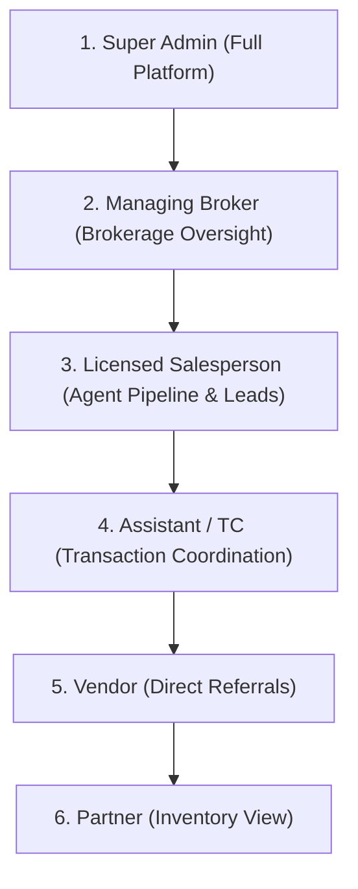

# Prime America Real Estate — Role & Privilege Matrix

This document defines the exact access controls, visible sections, operational dashboards, and button permissions for all user roles across the platform.

---

## 1. Role Hierarchy Overview

---

## 2. Detailed Role Feature Breakdown

### A. Super Admin (`admin`)
- **Primary Goal**: Complete platform governance, tenant configuration, compliance oversight, and technical health.
- **Top Metrics**: Active Users, Total Brokerage Deals, Active MLS Listings, CRM Contacts.
- **Accessible Pages**: Full access to all routes (`/transactions`, `/inventory`, `/marketing`, `/learning`, `/hr`, `/user-management`, `/settings`, `/tools/form-filler`).
- **Exclusive Actions**:
  - Tenant Organization & Domain Configuration.
  - User Impersonation for troubleshooting.
  - Database permission overrides per user.
  - System Health monitoring and log audit.

### B. Managing Broker (`broker`)
- **Primary Goal**: Brokerage deal supervision, agent performance tracking, license compliance, and commission authorization.
- **Top Metrics**: Active Deals, Under Contract, Closings (14 Days), Projected Brokerage Commission Volume.
- **Accessible Pages**: `/transactions`, `/inventory`, `/marketing`, `/learning`, `/hr` (roster view), `/settings`.
- **Key Actions**:
  - Roster sync with NY Department of State licensing database.
  - Stage-gate approvals on locked transactions.
  - Deal reassignment across agents.
  - 1099 tax commission summaries per agent.

### C. Licensed Salesperson / Agent (`salesperson`)
- **Primary Goal**: Personal business pipeline, lead conversion, listing promotion, and closing coordination.
- **Top Metrics**: Personal Active Listings, CRM Leads, Active Deals, Network Referrals, Est. Commission.
- **Accessible Pages**: `/transactions`, `/inventory/mls`, `/marketing/crm`, `/marketing/openhouses`, `/marketing/brand-marketing-hub`, `/learning`, `/network`, `/settings`.
- **Key Actions**:
  - Drag-and-drop Deals Pipeline cards.
  - Filter listings by "My Listings" vs "All Brokerage Listings".
  - One-click launch to `inventory.primeamericarealestate.com` for new listing drafts.
  - One-click SSO redirect to `openhouse.primeamericarealestate.com` to host open house sessions.
  - Convert CRM contacts directly into pipeline deal cards.

### D. Assistant / Transaction Coordinator (`assistant`)
- **Primary Goal**: Milestone tracking, document intake, inspection and appraisal scheduling, and closing preparation on behalf of assigned agents.
- **Top Metrics**: Assigned Active Deals, Due Today Tasks, Delegated Contacts, Needs Attention Milestones.
- **Key Actions**:
  - Upload compliance documents and tick off stage-gate checklists.
  - Update closing dates, inspection deadlines, and title milestone notes.
  - Log communication notes in CRM.

### E. Vendor / Partner (`vendor` / `partner`)
- **Primary Goal**: External service provider integration (e.g., home inspectors, mortgage loan officers, title attorneys).
- **Accessible Pages**: `/network`, `/settings` (Vendor) / `/inventory/mls` (Partner).
- **Key Actions**: View referral contact details, update status of assigned inspection/appraisal jobs.

---

## 3. UI Navigation Visibility Table

| Module / Page | Route | Admin | Broker | Salesperson | Assistant | Vendor | Partner |
| :--- | :--- | :---: | :---: | :---: | :---: | :---: | :---: |
| **Dashboard** | `/` | ✅ (Admin View) | ✅ (Broker View) | ✅ (Agent View) | ✅ (Assistant View) | ✅ | ✅ |
| **Deals Pipeline** | `/transactions/pipeline` | ✅ (All Deals) | ✅ (Brokerage) | ✅ (Personal) | ✅ (Assigned) | ❌ | ❌ |
| **CMA Valuations** | `/transactions/cma` | ✅ | ✅ | ✅ | ✅ | ❌ | ❌ |
| **MLS Listings** | `/inventory/mls` | ✅ | ✅ | ✅ | ✅ | ❌ | ✅ |
| **CRM Leads** | `/marketing/crm` | ✅ | ✅ | ✅ | ✅ (Assigned) | ❌ | ❌ |
| **Open Houses** | `/marketing/openhouses` | ✅ | ✅ | ✅ | ✅ | ❌ | ❌ |
| **Brand Hub** | `/marketing/brand-marketing-hub` | ✅ | ✅ | ✅ | ✅ | ❌ | ❌ |
| **Learning & NY 12-A** | `/learning` | ✅ | ✅ | ✅ | ✅ | ❌ | ❌ |
| **HR & Agent Roster** | `/hr` | ✅ | ✅ | ❌ | ❌ | ❌ | ❌ |
| **Tenant Management** | `/user-management` | ✅ | ❌ | ❌ | ❌ | ❌ | ❌ |
| **Settings & Profile** | `/settings` | ✅ | ✅ | ✅ | ✅ | ✅ | ✅ |
