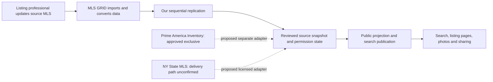

# Property-search data management audit

**Date:** October 8, 2026  
**Scope:** Read-only inspection of the local demo database and importer, synthetic in-memory failure reproductions, and current primary-source research. Recommendations below are proposed work, not implemented architecture or approved production behavior.

## The flow and its owners

The operational boundary matters: an inaccurate value entered in the MLS, an upstream delay, an importer failure, and a stale public page require different remedies. A fast website cannot establish that a property is still available. Likewise, an unchanged listing with an old modification date does not prove that synchronization failed.

Provider transport, timing, deletion, media and licensing facts are sourced in [provider research](mls-grid-provider-data-flow-research.md). OneKey's GRID connection is documented; NY State MLS's delivery route is unconfirmed. Do not assume the same adapter, source identifier or contract covers both. Inventory remains the owner of canonical Property identity under [ADR 003](adr/003-inventory-owns-canonical-property-identity.md); search remains a presentation consumer under [ADR 013](adr/013-modular-consumer-search-presentation.md).

## What this implementation actually does

The consumer does not query GRID while searching. `import.mjs` invokes the server-side client, retrieves a Property page, removes ineligible records from that page, downloads its eligible photographs, and then commits the records, media manifest and checkpoint. Search/detail/SSR endpoints read SQLite; images are served from local files after checking the current listing/media relationship.

| Component | Existing protection | Remaining boundary |
| --- | --- | --- |
| `client.mjs` | Source-filtered, sequential next-link requests; timeout/size bounds; initial viewability filter omitted from deltas; token confined to server | Only Property; no retry policy, quota ledger, source-health history or metadata drift checks |
| `import.mjs` | Database lock; bounded run; durable page resume; current-page revocations applied before image downloads | Manual invocation; a failed photograph stops the page and subsequent pages |
| `store.mjs` | Source/ListingKey identity; transactional page/checkpoint; explicit public projection; missing values preserved | Unconditional replacement; no per-record version guard or retained revocation version |
| `media.mjs` | Download/store; identity by source/key/revision; atomic file rename; recognized hosts; credential-free storage redirect | Demo-only hosts; no durable media-job state; generic failure stops importer |
| Detail refresh | Refreshes already-known source IDs without moving normal replication cursor | Does not discover new IDs, reconcile missing IDs, or refresh media manifests |
| Public server | Reads eligibility before serving a listing/image; unavailable listing returns 404; demo noindex | No feed-age publication policy; an unseen upstream revocation remains locally eligible |

Code inspected: [importer](../scripts/mls-grid/import.mjs), [client](../scripts/mls-grid/client.mjs), [store](../scripts/mls-grid/store.mjs), [media](../scripts/mls-grid/media.mjs), [detail refresh](../scripts/mls-grid/refresh-details.mjs), [media backfill](../scripts/mls-grid/backfill-media.mjs), [public server](../scripts/mls-grid/preview-server.mjs).

## Measured demo inventory

Read-only SQLite inspection at **2026-10-08T20:58:50Z**:

| Measure | Observed |
| --- | --- |
| Stored public listings | 491 |
| Sources | One: `onekey2` |
| Stored photos / listings with galleries | 178 / 11 |
| Listings missing per-record `obtainedAt` | 486 |
| Latest checkpoint commit | 2026-10-07T21:57:32.142Z; completed page chain, no pending next URL |
| Greatest GRID modification timestamp received | 2026-09-03T21:31:36.572Z |
| Unknown/negative price or missing status in stored projection | 0 / 0 / 0 |
| Records with LivingArea but neither its units nor a usable BuildingArea/units fallback | 268 |
| Residential rentals without projected LeaseAmountFrequency | 40 of 40 |

These describe the development sample and projection, not production inventory, MLS defect rates or current availability. A missing projected field may reflect source omission, mapping differences or our field inventory. Metadata and the original permitted source field must establish which. The photo count reflects selective backfills, not proof that the other listings have no photos at the MLS. The completed checkpoint means a page chain finished, not that ongoing refresh is configured or broker availability verified. Legacy missing import times must stay unknown.

## Confirmed failure reproductions

All reproductions used `openStore(':memory:')` and fictional records; the real database was not changed.

1. Store a listing at a newer GRID version with price 600,000. Apply an older version with price 400,000 through the same `apply(..., {checkpoint:false})` path used by maintenance. **Actual result: price becomes 400,000.** The overall resource checkpoint still reflects the newer timestamp.
2. Apply a newer revocation, then replay an older eligible copy. **Actual result: the listing becomes publicly retrievable again.** Deleting the row also discarded the local record of the revocation version.

This proves a local ordering vulnerability; it does not prove GRID sends records out of order during normal documented replication. Repair/backfill paths, restores and retries still need to be safe against older data. Existing tests cover repeated pages and equal timestamps within a page chain; they do not cover these two cases.

A further failure is visible directly in the control flow: all image work happens before the current eligible Property page is committed. One bad image, expiry or exhausted media budget can prevent new prices/statuses on that page from being published and prevent later pages from being read. Current-page revocations are prioritized, but later-page revocations can be delayed by the stopped run. A malformed page is rejected before any records are applied; silent skipping is not a safe recovery substitute.

## Proposed fixes, in order

### 1. Prevent regression and record eligibility separately

Add source/environment/resource identity, exact GRID version and approved minimal revocation metadata. Compare versions before updating facts; an older eligible replay must not restore a more recently revoked record. Same-version replays should be harmless, with conflicting same-version permission/payload evidence held for review rather than arbitrarily overwriting. Allow reactivation only from an authoritative later eligible version. Store only retention-permitted identifiers/version evidence after removal; purge the listing payload and public assets according to the agreement.

Normal source-record changes replace the permitted snapshot rather than patching only non-null fields. Otherwise a removed fact can linger. Expanded children need an explicit requested/present state: an unrequested Media collection is not an authoritative empty gallery. A confirmed replacement child set removes missing photos/rooms/unit types immediately; outdated photos must not survive while replacements download.

Acceptance: older-price replay is ignored; older-eligible replay cannot resurrect a newer removal; genuinely newer reactivation works; same-version replay does not create duplicate records; removed fields/children disappear; revocation reaches listing JSON, SSR, media and future index/cache/share surfaces.

### 2. Make synchronization observable and recoverable

Use one scheduled coordinator with a lease for sequential replication requests and independent checkpoints for each licensed source/resource. The guide's 15-minute cycle is a starting configuration, subject to the executed feed/display requirements. Persist run ID, start/finish, durable next-page progress, exact watermark, counts, failure category and quota usage. Distinguish a successful empty check from the last record change. Keep records/checkpoint atomic; never advance a cursor simply because JSON was fetched.

Retries must distinguish transient transport failures, authentication/approval failures, quota suspensions and malformed records. Bounded jittered retry is proposed for transient failures; do not repeatedly retry an exhausted quota or an unapproved token. A malformed record/envelope holds the resource's safe progress and creates a redacted operator incident. Do not silently skip a record and move past its timestamp. Coordinate all maintenance clients against the same quota budget and lease; current per-process pacing alone cannot do that.

GRID removal records disappear after seven days. Alert well before that interval; an outage that crosses the removal horizon enters **reconciliation required**, with affected publication constrained until an approved recovery establishes eligibility. No mass deletion based on a failed, partial or wrongly scoped enumeration. No generic overlap/range sweep or daily full redownload without provider-approved recovery semantics. [Deletion behavior](https://docs.mlsgrid.com/api-documentation/api-version-2.0#deleted-records).

Acceptance: kill/restart resumes safely; equal timestamp records survive page boundaries; a failed transaction does not advance progress; 401/403/429 and timeouts have distinct health states; incomplete runs are not reported healthy; an outage crossing the removal window cannot silently resume normal publication.

### 3. Stop photo failures from blocking current property facts

Separate the durable record/permission commit from media completion. Commit the reviewed facts, expected media key/revision manifest and safe progress together, recording pending/failed media states. Download immediately through bounded workers sized to the signed-URL deadline and shared quota budget. Never persist a signed URL as a consumer asset or long-lived job payload. A recovery job stores source IDs, expected revision and download state, then obtains a fresh URL only through an approved provider procedure.

Remove revoked/removed/revised old assets from public eligibility before attempting their replacements. An atomic photo commit makes the expected current revision ready; a failed transfer cannot attach obsolete bytes to a new record. The existing reuse-by-version and atomic rename mechanisms are useful foundations. Production host/CDN configuration needs explicit verification; the hard-coded demo host is not production-ready.

GRID's current media URLs expire after an hour and are single-use; ordinary repeated-download retry is inappropriate. Provider confirmation is needed for failures after URL consumption, allowed media concurrency and the optional separately arranged CDN path. [Current media migration](https://docs.mlsgrid.com/releases/upcoming-changes-to-media-delivery-migration-away-from-amazon-aws).

Acceptance: one failed image does not block a price/status/removal update; duplicates reuse durable originals; revised images cannot expose old bytes; crashes after download/before manifest commit recover without needless redownload; expired/consumed URLs do not enter a tight 429 loop.

### 4. Track provenance and freshness honestly

Keep separate timestamps where available:

- Source MLS modification: `OriginatingSystemModificationTimestamp`.
- GRID modification/version: `ModificationTimestamp`.
- Our observation and durable application times.
- Public search/index publication time.
- Last successful completed source/resource check.
- Separately, any brokerage confirmation of availability, with who/when/evidence.

The existing public projection omits the source MLS modification field. Its generic **Listing updated** wording uses GRID's timestamp; it does not identify when the agent changed the MLS. Add the reviewed timestamp field and choose precise consumer labels, such as **MLS GRID record updated** and **Search last synchronized**. Neither means **Availability confirmed**. Preserve absent timestamps rather than backfilling invented history. The timestamp distinction follows [GRID's conversion documentation](https://docs.mlsgrid.com/master#conversion-process--rules).

Suggested operator health axes: transport/catch-up state; publication eligibility; field-quality warnings; media readiness; coverage/completeness. Keep these separate from RESO `StandardStatus`, broker Approval Status and Publication Status under [ADR 005](adr/005-separate-statuses-and-own-shared-profiles.md).

Proposed metrics: check age by source/resource, grid-to-apply and apply-to-publication latency, revocation propagation time, oldest pending media job, request/byte quotas, malformed records, schema changes, incomplete cycles and unmapped permitted fields. Source-to-GRID latency is measured only when trustworthy comparable source timestamps exist; source entry delay before any MLS timestamp remains unmeasured.

### 5. Make data quality actionable without fabricating facts

Version a per-source metadata/field registry covering type, units, period, lookup mapping, public-display permission and attribution. Record reason codes such as source missing, unmapped, restricted, invalid or awaiting verification, but only when evidence establishes the reason. Unexpected metadata/lookup changes raise an operator alert; preserve unmapped evidence only where licensed rather than dropping data silently or exposing unreviewed fields.

Use consumer warnings tied to the specific decision: unknown lease period is not monthly rent; missing area units cannot support price-per-square-foot; unknown costs are excluded rather than zero. Quality flags should not remove otherwise eligible inventory by default. Financial estimates and comparisons can be disabled or qualified when necessary inputs are unknown. Maintain original supplied values beside normalized/derived values and record transformations, so a correction remains traceable.

Provide a property-specific **Report a data issue** workflow routed to an operator and the responsible listing professional/MLS through authorized channels. Record the affected field, evidence, source version and resolution. Prime America's own approved listings can be corrected at their owning Inventory record. Other brokerages' MLS facts must not be silently rewritten in our copy. Any independently verified note requires separate attribution, authority and display review.

When joining future feeds, use source-qualified listing identities and reversible links to Inventory Property identities. Never collapse listings or units merely because an address matches, and never borrow one feed's permissions to publish another feed's data. Private exclusives use their own approved publication/token rules, not MLS-derived eligibility.

## Immediate first implementation slice

The smallest useful next change is **version-safe updates and removals plus a synchronization-health ledger**, verified against fictional replay/removal/crash/empty-cycle fixtures. It corrects a reproduced local failure and makes subsequent replication work measurable. Scheduled resource replication and media isolation follow, with source-specific settings and provider-confirmed recovery behavior. This document does not authorize a live subscription, public release, contact with an external party or implementation of unapproved polling patterns.

## Verification and boundaries

The real SQLite database was opened read-only. Only aggregate listing/media/metadata counts were inspected; no inquiry/contact records or credentials were accessed. Synthetic reproductions ran in memory. No importer, refresh, backfill or live API call was run. No application code, real MLS record, schedule or deployment changed in this audit.

The research uses the supplied guides as reference material; instructions in them to contact support or request a grace period are not treated as user authorization. The proposed dashboard and recovery policy require implementation and agreement review; neither is claimed complete.

Repository verification after the audit: **63 Vitest files / 477 tests passed**, type checking passed and production build passed. Existing Workspace bundle-size warnings remain. These checks establish the current repository baseline; they do not demonstrate that the proposed data-management fixes have been implemented.
