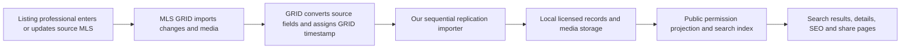

# MLS GRID provider data flow and reliability research

Checked October 8, 2026. Primary-source research only; no authenticated feed request, credential use, production subscription, or implementation change was made.

This note distinguishes published provider behavior from engineering recommendations and contractual permissions. Demo access establishes neither production coverage nor production display rights. Read it with `mls-grid-development.md` and the executed subscription documents when available.

## What happens before a listing reaches our search

MLS GRID describes timestamp-delta imports, media processing and conversion to RESO names/lookups, retaining local fields. It checks member MLSs each minute unless restricted by an MLS. **MLS Import Status** reports source-to-GRID performance. This polling policy is not a guaranteed publication SLA. The service uses replication, not live consumer search. [MLS GRID overview](https://docs.mlsgrid.com/master#mls-grid-data--conversion)

`ModificationTimestamp` is GRID’s modification time; `OriginatingSystemModificationTimestamp` is the source MLS modification time. Converted date fields use UTC; local passthrough date fields may retain their original representation. Records do not necessarily contain every metadata-defined field. Preserve that distinction rather than treating missing information as a negative answer. [Timestamps and dynamic fields](https://docs.mlsgrid.com/master#conversion-process--rules)

The overview’s older import explanation mentions S3; its newer media section documents migration away from AWS. Follow current media specifications below. [Current overview media section](https://docs.mlsgrid.com/master#media-files)

## Replication facts

The v2 API documents:

- A single source identifier per request; default ordering by `ModificationTimestamp`.
- Initial import with `MlgCanView eq true`; subsequent deltas without that filter, so removals arrive.
- Following every `@odata.nextLink` until absent.
- Tracking the greatest timestamp **received**, including records excluded from our product.
- Replacing changed records; media, rooms and unit types arrive as expanded children.
- Parent timestamps change with media changes; compare `MediaKey` and `MediaModificationTimestamp` and remove absent children.
- `MlgCanView=false` means removal from the local store; these records disappear from the feed after seven days.
- Up to 5,000 records per request, default 500; expansion caps requests at 1,000.
- `MlgCanUse` indicates licensed use categories: VOW-only/BO-only records do not become public IDX data.
- OneKey’s listed source identifier is `onekey2`; NY State MLS is not listed in the current source table.

[API v2 replication, signals, deletion, permissions and source table](https://docs.mlsgrid.com/api-documentation/api-version-2.0)

The current Best Practices Guide recommends a 15-minute replication cycle. It prohibits timestamp range queries and concurrent replication requests, discourages repeated identical requests and `or` queries, and prohibits per-listing OpenHouse pulls. Use sequential resource replication instead. It requires gzip/deflate acceptance. Its published caps are 2 requests/second, 7,200/hour, 40,000/rolling day, 4 GB/hour and 60 GB/day. Initial imports exceeding caps require arranging a grace period with support. The overview’s limit list omits the daily byte cap; budget against the stricter current guide and confirm subscription-specific accounting. [Best Practices Guide 2.1, pages 2–4](https://www.mlsgrid.com/s/MLS-Grid-Best-Practices-Guide-2.pdf)

Usage, Usage Logs and Primary Contact notifications expose concerning activity. Excess use can suspend a token and return HTTP 429; access is automatically restored when usage falls within limits. Account access is needed to inspect actual provider metrics. [Usage monitoring and suspension](https://docs.mlsgrid.com/master#rate-limits)

## Media changed materially in September 2026

The migration notice sets September 8, 2026 as the transition to `media.mlsgrid.com`. Download URLs are signed and must remain unchanged, expire after one hour, and permit one download. Repeated downloads or regeneration attempts within that hour can return 429. Obtain and download promptly; do not cache a feed URL for future delivery to consumers. S3 bucket transfers ended. The notice also offers a separately coordinated GRID CDN option without these single-use/one-hour URLs; this requires contacting GRID, not assuming existing access permits hotlinking. [Media migration notice](https://docs.mlsgrid.com/releases/upcoming-changes-to-media-delivery-migration-away-from-amazon-aws)

Media downloads require the subscription OAuth token as the `User-Agent` header, effective June 1, 2026. Treat that header as a secret in HTTP logging and telemetry. [Media access change](https://docs.mlsgrid.com/recent-releases/changes-to-mls-grid-media-access)

Our standard integration should download once into durable storage, then serve our own authorized copies and generated sizes. The API’s standard media workflow prohibits rendering its download URLs directly. [Standard media workflow](https://docs.mlsgrid.com/api-documentation/api-version-2.0#media)

## Licensing and coverage remain separate questions

OneKey confirms GRID delivery, broker-managed licensing, website review, approval and payment before first production-token issuance. Its stated approximate 98% IDX figure is a proportion of **OneKey inventory**, not a claim of complete NYC market coverage. Its support page currently lists $250/month/feed plus $20/month/license; confirm the actual quote rather than assuming the earlier $200 estimate. [OneKey Data Delivery Resources](https://support.onekeymls.com/hc/en-us/articles/27251536794644-Data-Delivery-Resources)

NY State MLS/MyStateMLS’s current FAQ advertises RESO API, XML and RETS custom IDX delivery. Older official member documentation mentions RETS. Neither establishes that Prime America receives NY State MLS through GRID. Confirm the approved delivery channel, transport specification, coverage and agreement with that provider. [Current NY State MLS FAQ](https://www.nystatemls.com/mls-real-estate-faq/), [member FAQ](https://www.nystatemls.com/Member_FAQ.html)

The GRID resources page separately publishes the license, IDX/VOW rules and AI addendum. API retrieval instructions do not replace those documents or expand a subscription’s scope. The current license/IDX PDF redirects and wiki were not retrievable with the research browser in this run; no unverified clause or display-update deadline is asserted here. Obtain the subscription’s authoritative versions before specifying retention, off-market display, attribution, fields, termination or AI use. [Official licensing resources](https://www.mlsgrid.com/resources)

## Engineering recommendations, not provider promises

These are proposed controls inferred from the failure modes above. They do not prove the current importer already implements them.

| Failure mode | Proposed control | Evidence to record |
| --- | --- | --- |
| Source agent delays entry or enters incorrect data | Preserve source values and timestamps; route a correction to the listing professional/MLS; keep any verified brokerage note separately attributed | Source field, source version, report and resolution |
| Upstream GRID delay | Monitor GRID import status alongside our own delivery timing; classify the responsible stage | Source modification, GRID modification, observed retrieval |
| Our replication fails | One worker/lease for sequential requests, bounded retries, durable page progress and transactional updates | Run ID, source/resource, next page, error category |
| Cursor advances before records are applied | Commit applied records and checkpoint together; never advance based merely on fetched JSON | Durable watermark and committed counts |
| Multiple records share a timestamp | Retain exact precision and page progress; test tie/crash behavior; seek GRID-approved boundary recovery | Boundary timestamp and IDs processed |
| Status or permissions disappear from a narrowed feed | Replicate broad licensed changes; apply search/status/location filters locally; remove revoked data through every downstream surface | Revocation and purge completion |
| Outage exceeds the seven-day removal window | Disable assumptions about retained eligibility; obtain an approved complete inventory reconciliation/rebuild | Outage duration, reconciliation completeness |
| Media expires or is consumed twice | Durable deduplication by source/MediaKey/version; prompt download and atomic storage; bounded queue sized to expiry/caps | Download state, expiry, object checksum, attempt outcome |
| A record loses photos/rooms/unit types | Replace the received child set, rather than append indefinitely; distinguish omitted/unrequested collections | Requested expansion and child manifest |
| A broken response looks like empty inventory | Validate transport/envelope before application; never mass-delete after partial/failed enumeration | Response validity, completion marker and scope |
| A permitted record is stale locally | Track successful check separately from property modification; expose honest checked/updated wording | Last complete check and last actual modification |
| One physical home exists in two feeds | Keep separate source listing identities; use a reversible property grouping layer rather than destructive merges | Match confidence, source lineage and separate permissions |

Do **not** introduce generic overlap/range polling as a presumed improvement: GRID discourages repeated requests and explicitly rejects timestamp range patterns in its guide. A `ge` boundary replay, overlap window, full enumeration or reconciliation cadence needs provider-approved semantics and a budget before adoption. Similarly, a failed media response may have consumed a single-use URL; do not blindly retry the same signed URL or generate replacements repeatedly. Confirm the recovery procedure.

Recommended health dashboard: per source/resource last attempted and last complete run, durable watermark, pages/records applied, backlog, removed-record purge time, malformed-record count, media queue age/failures, requests and bytes by hour/day, and successful public-index publication. A listing’s old modification timestamp alone is **not** evidence that the feed is broken: unchanged properties may legitimately be old. A fresh successful poll alone does **not** prove that an agent corrected the underlying fact.

## Questions to confirm before production

1. Actual licensed sources and NYC borough/property-type coverage; NY State MLS’s delivery route and duplicate overlap with OneKey.
2. Upstream availability/service commitments, per-source restrictions and any contractual public-update deadlines.
3. Exact cursor precision, equal-timestamp ordering, crash recovery and empty-cycle behavior; approved reconciliation after long outages.
4. Whether byte/request caps include media/CDN downloads, and allowed concurrency for media separately from sequential API replication.
5. Recovery when a signed media download fails after the URL is consumed; replacement URL procedure, throttling scope and optional CDN terms.
6. Subscription-specific public-field permissions, off-market retention and purge obligations across storage, search, caches, SEO and share cards.
7. Authoritative executed AI addendum, license and IDX/VOW rules; do not infer AI permission from API access.

## Research limitations

No production latency, defect rate, inventory completeness, actual GRID account metrics or subscription terms were measured. Public documentation establishes the transport contract and published guidance, not a finding that MLS GRID itself is unreliable. Source data quality, upstream transport, our ingest and public publication are separate potential causes and must be diagnosed separately.
