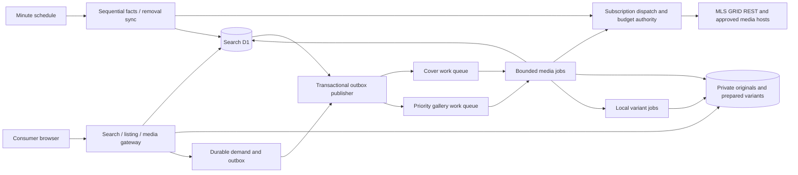

# MLS listing and media performance specification

Status: **Proposed implementation specification**, October 30, 2026. Research and read-only inspection only; no infrastructure, configuration, import, permission, or public-release change is authorized by this document itself.

Owner: Prime America Real Estate. Scope: the isolated consumer search service and its existing approved OneKey / MLS GRID subscription. This specification does not change the Workspace, Placester, corporate website, MLS license, or listing-publication policy. It proposes replacing the scheduling choices in [ADR 017](adr/017-on-demand-listing-galleries.md), while preserving the replica and removal protections in [ADR 016](adr/016-production-search-replica.md). Record the accepted architectural decision when implementation is approved; this proposal is not that approval.

Supporting due diligence: [MLS GRID constraints](mls-grid-ingestion-constraints-research.md), [Cloudflare capacity and pricing](cloudflare-ingestion-capacity-research.md). Sources checked October 30, 2026. Requirements below distinguish **verified source rules**, **observed implementation**, **proposed targets**, and **unresolved provider questions**.

## 1. Outcome

Consumers must receive already stored search results, readable listing facts, and a prepared cover without waiting for MLS GRID, a background import pass, geocoding, or image transformation. Missing gallery photos are optional asynchronous work with a prompt, fair priority path. Source changes and permission removals continue even if every media job is stalled.

The objective is a production-quality search experience, not the largest number of parallel Workers. Provider quotas bound source throughput; local preparation and serving determine how much of that delay reaches consumers. No promise of instant upstream publication, complete market coverage, all photos within 24 hours, or unlimited global concurrency is made without measured capacity and applicable source authorization.

### Current live baseline — replaces the October 27 assumption

Observed in the signed-in [owner dashboard](https://preview-search.primeamericany.com/ops/mls-sync) at **October 30, 2026, 9:09:52 AM America/New_York**; large counts captured 9:09:40 AM. These are an operational snapshot, not an immutable vendor total or a source-to-source market comparison.

| Measure | Observed value | Meaning / limit of the evidence |
| --- | ---: | --- |
| Replication phase | Keeping listings up to date | Initial reconciliation reported complete; do not plan a needless fresh bootstrap. |
| Retained permitted NY listings | 46,532 | Current licensed/filtered replica, not every property in New York or every record examined. |
| Listings with at least one ready photo | 46,471 | 99.87% of retained listings. The remaining 61 need classification: no eligible source image, pending work, or failure. |
| Source records examined | 163,918 | Includes excluded records; not a display inventory count. |
| Public media manifest entries | 1,036,580 | Mutable local known manifest denominator, not an overall source import percentage. |
| Ready / pending / failed originals | 57,053 / 979,503 / 24 | About 5.50% of known originals ready. Large pending galleries are expected under the current cover-only background policy. |
| Downloading / requested galleries | 0 / 0 | No active demand at this snapshot; pending originals alone do not prove a stuck importer. |
| Last complete feed check | 9:08:03 AM ET | Latest observed pass 9:09:01–9:09:02 AM, outcome `ok`, zero pages/records. Zero can mean polling was not due; admin currently cannot distinguish that from an empty source response. |
| Conservative source request windows | 64 / 6,000 hourly; 1,872 / 35,000 daily | Low utilization at this snapshot. Not evidence of the provider's own accounting or future capacity. |
| Conservative source byte windows | 0.01 / 3 GB hourly; 0.60 / 50 GB daily | Includes app accounting reservations; not an invoice. |
| Image optimization attempts this month | 201 / 1,000 app cap | Cap has **not** been exhausted. It is a future risk, not the observed cause today. Attempts are not verified derivative coverage. |
| Map-ready listings / daily geocoder budget | 4,439 / 46,532; 1,000 / 1,000 | Geocoding budget is exhausted. This is separate from listing/gallery availability; no guessed coordinates or silent map exclusion. |

Historical benchmark, October 27: a real listing went from 3 to 12 ready photos in 164.818 seconds. Persisted scheduling timestamps imply approximately 147.945 seconds waiting and 16.873 seconds processing the refresh/download work. It demonstrated correctness, not a consumer latency SLO. See [recorded verification](verification/on-demand-listing-preview.md). Today's latency distribution has not been profiled; do not present that one historical sample as p95 or a competitor benchmark.

## 2. Findings and boundaries

Observed code at search branch commit `17e06c1`:

- [sync.mjs](../workers/property-search/src/sync.mjs) shares a 240-second feed lease across primary pages, requested galleries, covers and some location work. A pass can spend roughly 150 seconds on work; minute-level cron triggers cannot preempt it. Six 100-record pages are followed by media work.
- [client.mjs](../scripts/mls-grid/client.mjs) expands `Media,Rooms,UnitTypes` even for the primary traversal. It bounds decoded pages to 8 MiB in production. Increasing only `$top` is unsafe.
- [enrichment.mjs](../workers/property-search/src/enrichment.mjs) stores demand, but the scheduled importer consumes it. Manifest acquisition/attempt timestamps produce a parent-wide conservative one-hour wait. Queue admission is globally limited to 500 records; rejected admission currently lacks a distinct consumer state.
- [replica.mjs](../workers/property-search/src/replica.mjs) correctly retains precise source versions and tombstones, but applies complete-row/manifest semantics. Feeding facts-only rows through that path unchanged can delete retained media or prevent same-version full hydration.
- [image-variants.mjs](../workers/property-search/src/image-variants.mjs) persists derivatives in private R2, but creates a missing size during the photo read, caps attempts at 1,000/month, and may fall back to a large original. Keep the persisted derivative benefit; remove this avoidable critical-path work.
- [store.mjs](../workers/property-search/src/store.mjs) attaches ready galleries and public facts to search results, and calculates matching aggregates on requests. Card payloads and scanned rows need explicit bounds; more downloaded galleries must not make search responses grow without limit.

The new work must preserve licensed scope and current consumer-permitted facts. A smaller search response must not hide the detailed facts view or recast an unintegrated field as absent at the MLS. Room/unit integration and the authorized field inventory need explicit completeness accounting.

Out of scope: changing branding, mortgage calculations, communications delivery, AI processing of MLS data, importing Member/Office profiles, new feed subscriptions, mass geocoding, or opening the public site. Existing OneKey/subdomain approval reported by the owner is not being requested again.

## 3. Verified constraints and open gates

The [API v2 documentation](https://docs.mlsgrid.com/api-documentation/api-version-2.0) supports top-level `$select`, a general 5,000-record ceiling and 1,000 with expanded resources. These are maxima, not page-size or memory recommendations. Follow provider next links and preserve source timestamp precision. Incremental traversal includes excluded/removal records; removal tombstones disappear after seven days.

The official [Best Practices Guide](https://www.mlsgrid.com/resources) requires sequential replication rather than threaded/process or timestamp-range splitting. It lists 2 requests/second, 7,200/hour, 40,000/day, 4 GB/hour and 60 GB/day. Keep existing lower app ceilings until accounting is verified; an exception requires advance provider agreement.

[Media documentation](https://docs.mlsgrid.com/) requires downloaded local copies, not hotlinks; signed URLs are single-use, expire after an hour and must not be cached for later use. Repeated downloads / URL generation to download media again can trigger 429. Public wording does **not** clearly establish a blanket hour-long embargo on different never-downloaded sibling photos. Written clarification is required before relaxing this behavior for that scenario. API versus media/redirect quota accounting and allowed media concurrency are also unresolved.

Current public IDX rules and the executed OneKey agreement govern display permissions, attribution, exclusions, freshness, derivatives and retention. Research of public rules is not a new legal sign-off. Preserve the existing strict public freshness/eligibility gates and 2,500-result display cap; that display cap is not an import/storage limit. Verify any proposed new derivative/cache behavior against applicable terms, with written approval only where those terms require it.

Do not block independent, safe scheduling separation on a bulk-import exception that may not be needed. Do not claim the cold-gallery timing targets below are achievable in an unresolved cooldown scenario.

## 4. Proposed architecture

These are independent lifecycles, not necessarily separate deployments. Reuse the existing private ingestion Worker for cron and queue handlers where its isolation/memory permits. The public read Worker has no provider secret. Add Cloudflare Queues for prompt durable delivery, a D1 transactional outbox, and one subscription-scoped dispatch authority. A Durable Object is the preferred coordinator for durable pacing/priority; an atomic-D1 implementation is acceptable only if it proves the same guarantees. Choose one authority, not competing limiters or a new global singleton on consumer reads.

The primary cursor lease protects **only** source fact traversal and atomic checkpoint commits. No photo transfer, transformation, gallery, geocoding or queue wait holds it. Independently fence each hydration/media job. Serialize all MLS REST requests conservatively pending clarification, while interleaving due deltas and admitted identifier lookups. If interleaving is not authorized, provider confirmation or an approved alternative is a rollout gate for that lane.

### 4.1 Facts and permissions first

1. Reuse the completed replica and exact committed cursor. Do not restart from zero or discard existing originals.
2. Introduce an explicit facts-request shape: omit `$expand`; select every required identity, eligibility, version, search/display field and source photo-change signal from a reviewed inventory. Missing eligibility fields fail closed. Do not send a literal `$expand=none`.
3. Start at the proven 100-row bound; benchmark 250, 500 and 1,000 unexpanded rows. Choose the largest safe measured size. Consider larger unexpanded pages only after profiling and validating client bounds. Keep an 8 MiB decoded cap initially; adapt downward on payload errors without losing the cursor. Record wire/decoded bytes and heap/CPU. Page maxima alone justify no throughput claim.
4. Commit core facts, permission removals, versions, dependent job/outbox records and checkpoint atomically. No image hashing or per-photo loop belongs in this transaction.
5. Schedule source polling from previous **attempt start / due time**, not `last_complete + 60 seconds`; completion-time jitter currently can skip the next minute. A due check records `source_checked`, `not_due`, `busy`, `backoff`, or `failed`, separately from record count.
6. Deltas update status, price, permissions and source photo-change markers. Only an actual manifest change requires manifest refresh; unchanged photos are reused.
7. Future full verification keeps one sequential snapshot plus unfiltered changes/removals from its start, then bounded pruning. Apply the existing six-day safety threshold to both the delta gap and the age of a reconciliation generation before the seven-day removal horizon. If snapshot plus catchup exceeds that threshold, invalidate/fence that generation and start a fresh verification while retaining safe cached data; never finalize readiness or prune from an overlong generation. A successful page is not proof of completeness.

### 4.2 Partial responses must be safe

Track independent `core_version`, `details_version`, `manifest_version`, hydration/completeness flags and the highest authoritative permission/tombstone version. Preserve sub-millisecond precision as today; do not derive source ordering from JavaScript millisecond dates.

- Not requested, requested-and-empty, supplied-and-restricted, and malformed are distinct resource states.
- Omission when a resource was not requested, or response completeness is unproven, never deletes its stored set. In a validated explicitly requested complete snapshot, an expansion may be omitted because it is empty; treat that proven absence as an empty replacement and remove old entries. Request shape and validated response semantics determine completeness, not the mere presence of a JSON key.
- A same-version details/manifest response can fill a missing projection without moving the primary cursor or overwriting a newer version. An older hydration response cannot defeat newer facts, a permission change or a tombstone.
- Do not serve an old details/manifest snapshot as current after a newer core version invalidates its relevant permissions or facts. Keep a safe core overview available where permitted; invalidate or mark pending dependent fields and hide uncertain media until revalidated.
- Facts already needed for consumer details remain available locally. Hydration of additional permitted arrays is not permission to shrink the reviewed field inventory. Unknown fields enter review rather than raw JSON passthrough.

### 4.3 Durable work and prompt demand

Use durable D1 job state with unique `(source, listing, media-or-projection revision, job kind, variant profile)` identities; listing-hydration requests may coalesce at their appropriate projection version. Jobs carry priority, eligibility generation, `not_before`, bounded attempt count, fenced claim token/expiry and sanitized failure category. Suggested states: `pending`, `claimed`, `retry_wait`, `ready`, `superseded`, `cancelled`, `dead_letter`.

Write jobs and outbox entries in the same transaction as their triggering facts/manifests. Publish after commit, retry unpublished rows, and acknowledge an outbox send only after queue acceptance. A crash between D1 and send cannot lose work; duplicate delivery cannot duplicate a successful download or attach an obsolete revision. Record intent, not signed URLs. No photo bytes, provider credentials or signed media links belong in queue messages, logs or durable retry records.

An eligible listing/gallery visit writes/coalesces demand and attempts immediate queue publication. Return promptly after durable admission; never run provider fetches or sleep for source slots in the consumer HTTP request. A delayed publisher still has its persisted outbox fallback. Distinguish accepted, already ready, cooldown, capacity-deferred, unavailable and service-failure states. Do not label a queue rejection as a successful refresh.

Use separate priority-gallery, cover and local-variant delivery queues, with tiny identifier-only messages and explicit acknowledgments. Initial proposed batching: one job, zero batching delay for priority work; small bounded cover/variant batches after measurement. Queues does not provide a hard latency SLA or cross-queue fairness. D1 remains authoritative; expired/retried queue messages cannot silently lose persisted work. Configure a DLQ plus operator-visible durable failures and bounded re-drive.

### 4.4 Global source scheduling and fairness

One subscription-scoped authority covers the existing importer, new jobs, retry/redirect requests and owner feed diagnostics. Preserve request pacing and conservative rolling byte/request reservations across restarts. Until provider clarification, account for media and approved redirects within the same app ceilings. A separate queue or additional Worker never creates a separate allowance.

The authority must order actual network starts, not issue independently usable future permits that can bunch after Worker delays. REST sequentiality lasts through bounded response consumption/abort; it is not merely spacing request starts. The coordinator must not hold a whole-gallery lock that blocks due REST work. Validate a concrete private service/RPC/streaming design in the first spike before choosing its implementation.

Proposed starting allocation when all classes are backlogged: 30% for source facts/removals, 50% for urgent galleries and 20% for missing covers. Idle allocations are borrowable. A due freshness deadline outranks optional work. Weighted borrowing never consumes the non-borrowable core headroom described below. Age jobs and round-robin across listings so one large/popular gallery cannot monopolize the source. Measure, then tune; these are our scheduler policies, not provider rules.

Keep existing lower ceilings (6,000/hour, 35,000/day, 3 GB/hour, 50 GB/day and at least 550 ms between starts) initially. Preserve the old ledger's relevant rolling windows at cutover. Reserve non-borrowable headroom for measured delta/removal demand in **both hourly and daily request and byte windows**, with recovery/overlap margin. Establish the reserve from observed peak core use before rollout; optional jobs cannot borrow it merely because a minute is idle. Throttle optional prewarming before any window loses that headroom. Byte reservations remain conservative on unknown/incomplete outcomes; successful bounded responses may settle unused reserved bytes. Do not refund failed request counts.

Start with one in-flight media transfer in the new path unless existing documentation or written confirmation supports a higher number; the old configured three is not evidence of source approval. Increase toward three or ten only with approval where needed, spare global quota and measured heap/CPU/D1 headroom. Ten copies of the current importer and independent timestamp shards are rejected designs.

### 4.5 Media correctness and retry ledger

Resolve a bounded current manifest using the provider-supported `ListingId` lookup just before transfers. Reuse ready identical revisions. Distinguish URL acquired, download never attempted, request dispatched, success, definite failure and unknown outcome. A manifest read must not reset every pending sibling's download-attempt age.

Before any provider network request, atomically persist the fenced attempt identity, quota reservation and dispatch intent (`may_have_dispatched`). Settle its result afterward. There is no atomic transaction spanning D1 and the external fetch: a crash after intent but before a recorded result is conservatively uncertain even if the process may not actually have sent the request. A crash between dispatch and outcome commit must never look like an unattempted photo. Indeterminate timeouts require conservative retry treatment. The proposed faster cover-to-gallery transition for never-downloaded siblings remains behind the written-clarification gate; do not silently remove the present protection. No signed URL is cached for a later invocation; unfinished work stores IDs and resolves again only when allowed.

Retain strict approved-host/redirect validation, secret-header rules, raster sniffing, timeouts, byte bounds and current original hashes. Validate eligibility and exact media revision before transfer admission, before marking R2 bytes ready and before any response/304. A superseded completion can leave an inaccessible orphan for permitted cleanup, never a public reference. Confirm retention obligations and inventory before irreversible object deletion.

Separate error circuits. A photo 404, invalid/expired signed URL, or derivative failure must not declare the MLS REST credential invalid or stop fact polling. A confirmed REST credential failure is a different source-wide condition. A media 429 may be item-specific or account-wide; use the confirmed provider classification, otherwise apply conservative source backoff with a visible uncertainty reason. Local R2 reads and safe local derivative work continue during upstream backoff.

### 4.6 Covers, warm galleries and viewing

Classify the 61 listings without ready photos before creating a false 100%-cover promise. Denominator: retained listings with at least one confirmed eligible source image. Distinguish source supplies none, not integrated, pending, permanent source failure and transient failure. Do not remove photo-less listings from default search to disguise incomplete coverage.

Prepare one cover and **two fixed card widths** for each eligible listing; initial proposal 480 and 1080 pixels with matching client `srcset`/default URLs. Reuse originals and existing valid variants. Do not leave a third default width that still requires a cold transform. Preserve full source composition, aspect ratio and visible watermark/disclosure content, including CSS presentation. Tune quality through reviewed examples and byte budgets, not maximum quality numbers alone. Set a target of **at most 150 KiB for the first useful mobile cover/gallery preview**, leaving transfer/decode headroom at the test network speed. Use a ready card-sized preview immediately in the full-window viewer, then upgrade to a larger prepared display representation; the large display file is not the first-image timing assumption. Do not reduce disclosure/watermark legibility or substitute a meaningless blurred placeholder to pass the byte target. Record quality-constrained exceptions; if their frequency breaks the percentile target, performance has failed and requires review rather than silent exemption.

Warm additional gallery originals/display sizes only for a bounded active-NYC hot set: recent changes, explicit saves/visits, and source open-house signals where actually integrated. No fabricated demand, demographic ranking or private-profile inference. Let explicit demand outrank optional popularity prewarming. Compute the hot-set size from measured available quotas/storage and recent distinct gallery opens, not a fixed promise to fetch the entire million-photo backlog.

Run transforms after original retention as local jobs independent of MLS request slots. Persist derivatives by original revision + fixed profile version. Deduplicate transform work. Create viewer sizes only for admitted hot/demanded photos; never eagerly generate every variant for every source image.

Search/media reads never call the Images binding as their normal preparation path. Serve the best ready small representation immediately; if extra quality is not ready, queue preparation without silently substituting a multi-megabyte original on every card. Keep an explicitly chosen original-quality action where permitted. Empty/no-source photos have an honest placeholder, not an endless loading spinner.

Keep the current full-window viewer, arrows, keyboard navigation, swipe, quality option and current-photo identity during arrivals. Preserve focus when the originating button is replaced. Avoid rebuilding cost/inquiry inputs on photo-only updates. Prefer push/version notification if a small existing mechanism fits; otherwise poll local status with a bounded cadence, jitter/backoff, visibility pause, cancellation and no indefinite per-visitor five-second polling.

### 4.7 Read path and permission-safe caching

Return bounded card DTOs and one cover plus counts/status from search, not all ready gallery entries and all detailed facts for 96 cards. Details remain on the listing endpoint. Fetch gallery manifests in bounded pages if needed, with stable navigation/count semantics. Preserve canonical listing paths, SSR facts, share metadata, attribution and the 2,500-match display ceiling.

Measure matching aggregate scans, broad filters, deep offsets, withheld-address paths and map queries. Cache or precompute non-sensitive counts only with explicit freshness/invalidation rules; a stale count must not authorize a revoked record. Fix SQL/index/payload costs shown by query plans and `rows_read`, not speculative index proliferation.

Keep an always-executed outer authentication/eligibility gateway. Private R2 persistence is the baseline byte reuse. An optional inner immutable-byte cache may improve public delivery **after** a current permission/manifest check; it must not be directly routable. No cache hit, conditional 304, transform completion, stale fallback or rollback may bypass that gate. Fail closed on eligibility lookup failure. Public facts/search response caching needs its own generation-safe invalidation proof and is not required for the first rollout.

Cloudflare documents that legacy Cache API is unavailable behind Access; [new Workers Cache](https://developers.cloudflare.com/workers/cache/examples/) is a distinct mechanism. Check pinned tooling support and test the actual preview/public hosts before enabling an inner cache. Do not assume a localhost cache result proves production behavior.

## 5. Performance acceptance targets

These are proposed engineering targets, not measured results, platform guarantees or unconditional upstream promises. Establish a reproducible baseline before implementation. Report p50/p95/p99 and sample count; separate cold/warm, source wait, provider transfer, local preparation and consumer network time. Test US/EU/APAC, desktop/mobile, and the actual Access host as well as an authorized public-equivalent test path.

| Path / workload | Proposed acceptance criterion |
| --- | --- |
| Cached search, 24 cards, representative filters | API p95 ≤500 ms, p99 ≤1,000 ms; no provider/Images request; JSON ≤150 KiB decoded excluding separate images. |
| Cached detail / local gallery metadata | API p95 ≤500 ms; missing optional photos never delay core facts. |
| Prepared card / current gallery image | Media TTFB p95 ≤500 ms across stated regions; first useful card/gallery preview ≤1.5 seconds on the defined mobile network profile, targeting ≤150 KiB initial bytes. Larger quality upgrades measured separately. Instrument eligibility lookup and quality/size exceptions separately. |
| User interface | Field/RUM goal p75 LCP ≤2.5 s, INP ≤200 ms, CLS ≤0.1; publish network/device profile and sufficient sample size. |
| Durable demand admission | p95 ≤500 ms for accepted/coalesced/capacity-deferred response; truthful status. Queue delivery/slot wait measured separately. |
| Healthy cold gallery, one active unique cold request, ≤20 photos, ≤1 MB mean original, approved request behavior, permits available | Processing begins p95 ≤5 s; next useful missing image p95 ≤10 s; gallery originals ready p95 ≤60 s. Run ≥100 repeatable fixture/load samples and bounded approved live checks. Provider transfer/cooldown/redirect measurements must validate feasibility before sign-off. |
| Saturated cold demand / provider cooldown | Immediate cached overview and cover; explicit deferred/cooldown state; no false deadline. No claim that 1,000 simultaneous unique cold galleries can meet the single-request target. |
| Facts under stalled photos/transforms | Due polling attempts continue on a 60-second intended cadence, p99 dispatch gap ≤90 s under healthy provider/available budget; no dependence on media lease or queue depth. |
| Source freshness | Proposed p95 ≤3 minutes for `core_committed_at − provider ModificationTimestamp`, with explicit clock-skew/backdated-timestamp exceptions and source-check-gap reporting. Our first observation time cannot stand in for provider availability or hide polling delay. Source MLS-to-GRID lag is a separate provider measure. Tombstone denial at next read after committed removal; do not wait for media cleanup. |
| Cover preparation | ≥99% of source-photo-eligible retained listings have a ready cover and two card sizes before release; classify every exception. New/changed eligible covers p95 ≤5 minutes under healthy admitted load. Existing originals can produce variants during source backoff. |
| Initial / reconciliation completion | No invented vendor total or fixed finish SLA. Measure safe page throughput and backlog, project a range with confidence/assumptions; a final sequential sweep/catchup establishes membership. |

Use a published synthetic dataset reflecting observed size/skew without copying restricted MLS payloads into fixtures. Mobile profile: 390×844 viewport, approximately 150 ms RTT / 1.6 Mbps down / 750 Kbps up, recorded CPU throttle and browser version. Also validate tablet, wide/dual-window layouts, reduced motion and keyboard navigation; physical foldable hinge behavior is a separate device test.

Load tests must include 1,000 concurrent **cached** visitors with a stated request cadence. Start low and ramp in an isolated environment; do not load-test MLS GRID or production unintentionally. A continuous high-concurrency monthly cost scenario is separate from passing a short capacity test.

## 6. Cost and capacity plan

All figures are USD planning arithmetic at researched public pricing, before tax/shared usage/negotiated terms. They are not a bill or spending authorization. Confirm whether the $200 ceiling includes MLS fees, other Cloudflare applications, logs, geocoding and taxes. The owner's report of fee-free OneKey access is not overridden by an invented feed charge; verify the agreement/invoice.

| Scenario | Assumptions | Approximate incremental service usage |
| --- | --- | ---: |
| Prepare two widths for the observed retained inventory | 46,532 ×2 =93,064 unique transforms; paid Images tier and full 5,000 included allowance available | $44.03 Images usage before billing rounding; permitted originals still need to exist. |
| Modest ongoing image preparation | 20,000 new original/profile pairs that month; free allocation otherwise unused | $7.50 Images usage, not an observed forecast. |
| Store 1 million originals | 0.5 MB assumed mean, about 500 GB stored for the full month; R2 Standard allocation available | About $7.35 storage/month. Transfer time/quotas and other operation/compute costs remain separate. |
| Prepare two widths for all 1 million photos in one month | Two million new unique transform pairs | About $997.50 Images usage; explicitly rejected under a $200 ceiling. |
| One million ordinary queue jobs | Three operations/job, one-million included operations available, no retry/chunk overhead | About $0.80 Queues overage; not the entire job cost. |

See [capacity research](cloudflare-ingestion-capacity-research.md) for current Workers, D1, R2, Queues, DO and Images pricing/citations. Images binding output is not automatically cached; persisted R2 derivatives avoid re-encoding and later binding calls. Unique billed transformations differ from our current attempt counter. Account plan activation and shared allowances must be checked; do not merely raise the app cap while the provider plan would reject extra transformations.

A low-traffic cover-preparation month may fit roughly $50–$80 infrastructure if shared allowances remain available, total storage is around 50 GB, and other use is modest. Continuous 1,000-user concurrency is a different workload: at ten uncached requests/minute/person for 30 days, 432 million requests and an assumed 10 ms CPU/request produce about $217.40 Workers plus $151.92 for one R2 GET/request, before D1/storage/Images. This is a stress-cost scenario, not our traffic forecast. Edge compute and free R2 egress are not an unlimited $200 guarantee.

At rollout, set a measured monthly allocation for cover warmup, changes, optional gallery prewarming, operations and reserve within the **remaining** budget. Proposed warning at 70%, disable optional prewarming at 85%, and stop new optional transforms before the projected ceiling; retain safe metadata/removal work and prepared small-image serving. Alerts are not hard billing caps. Inbound abuse can still incur request charges: rate-limit demand by network/session plus global unique-job admission, validate retained listing IDs, dedupe, and expose `capacity_deferred` rather than unbounded growth.

Capacity equations:

- `requests = fact_pages + hydration_queries + counted_media_attempts + counted_redirects + retries` (vendor accounting scope pending confirmation).
- `completion_time >= max(requests / approved_rate, bytes / approved_byte_rate)`, also bounded by rolling hourly/day windows and local processing.
- Example only: 979,503 pending images with one initial media request plus one charged redirect each would require 1,959,006 requests, nearly 49 days at 40,000/day, or about 56 days under our 35,000/day app ceiling, **before** other traffic. This conservative scenario is not a claim that CDN requests actually share that quota; it shows why the scope question must be answered before any 24-hour promise.
- Storage and transform budgets use measured average/p95 bytes and actual new revisions. The full-gallery backlog is not the priority-cover backlog. Count D1 index/write amplification and scanned rows; measure database size against its per-database limit.

## 7. Failure, integrity and recovery acceptance matrix

| Scenario | Required behavior / evidence |
| --- | --- |
| Source 401/403 vs media 403 | Separate credential and media circuits; classify accurately; no false global credential failure from one photo. |
| Source/media 429 or exhausted app window | Persist scope/reason/backoff and next eligible time; do not multiply retries across consumers. Facts receive reserved capacity where source rules allow. |
| Partial `$select` page / omitted expansions | No media/room/unit deletion; missing required permission fields cannot publish. |
| Same source version arrives with missing projection | Fill that projection exactly once without moving global cursor or overwriting newer facts. |
| Tied/fractional timestamps / invalid offset | Safe committed progress with overlap and idempotence; no source updates or removals skipped. |
| Crash after D1 commit, before queue send | Outbox republishes; no missing cover/demand job. |
| Duplicate queue delivery / simultaneous visitors | One fenced active job per identity; successful ready revision reused; no duplicate source download. |
| Crash before intent / after intent but before send / after send before result commit | Exercise each boundary: absent intent cannot have an authorized dispatch; any unfinished pre-recorded intent is conservatively uncertain and uses permitted recovery, not a blind single-use retry. |
| R2 succeeds, D1 commit fails | Reconcile bounded orphan/claim state; never expose unreferenced bytes or duplicate transfer without checking retained success evidence. |
| Listing revoked / address suppressed during transfer | Finishing job cannot restore access or reveal suppressed content. Photo, variant, API, SSR, map, sitemap and 304 paths enforce current permissions. |
| Manifest changed / same MediaKey but new revision | Old completion rejected; new identity scheduled; source ordering remains precise. |
| Image preparation budget exhausted | Keep serving prepared small variants; no mass original-size fallback or false missing-listing result. |
| R2/transform queue stalled | Listing/removal synchronization continues; retry state is visible; stored images still serve where available. |
| D1 overload / unavailable eligibility check | Bound retries/backpressure; fail closed for data/media authorization; no stale-cache bypass. |
| Coordinator restart / old importer overlap | Durable pacing/backoff/budget survives; only one active dispatch authority and primary cursor owner. |
| DLQ / queue message retention exceeded | D1 remains authoritative and operator-visible; safe bounded re-drive; no silent job loss. |
| Missing/unmatched location or geocoder exhausted | Search listing remains visible; map coverage status honest; no guessed pin or gallery delay. |
| Delta gap or reconciliation-generation age approaches the removal horizon | At the six-day safety threshold fence/invalidate an overlong generation and verify fresh membership plus catchup; never prune/finalize readiness from a snapshot whose removals may have aged out. |
| 1,000 viewers / many cold listings | Public cached path does not depend on coordinator; fair bounded cold admission; documented degraded state and measured costs. |

## 8. Admin and observability

Add independent panels for facts, covers, galleries, variants and map coverage. Display source check due/start/finish/last successful check, core lag, queue depth/oldest due age by class, claimed jobs, ready/eligible covers, classified no-source exceptions, fully ready galleries, per-revision attempts/unknown outcomes, DLQ items, derivative coverage, source reservations/settled usage, throttles and current budget pauses. Do not display pending originals as an undifferentiated failed initial import.

Trace with sanitized correlation IDs: demand accepted → job published → claimed → source slot admitted → REST completed → first new original stored → first useful variant ready → browser displayed. Keep timestamps for each stage, not one total. Capture provider status/category, body byte lengths, local CPU/heap, D1 duration/rows, R2 operations and cache behavior. Do not log tokens, auth headers, signed URLs, raw MLS/private remarks, consumer email or precise browsing identities.

Proposed dashboard alerts: healthy-provider poll dispatch gap >3 minutes; steadily growing urgent queue beyond admitted target; repeated unknown media outcomes; missing covers >1% of eligible inventory; credential failure; approaching quota/cost headroom; DLQ growth; data gap approaching six days. Alert delivery/recipient and retention policy are implementation configuration, not permission to send messages now. Retain operational aggregates long enough for a 30-day comparison; cap/sanitize/samplerate detailed traces and price log volume.

## 9. Delivery slices and rollout

| Slice | Deliverable | Exit evidence |
| --- | --- | --- |
| A — Baseline and provider clarification | Read-only live baseline, field/projection audit, actual account plans/bytes, written answers on quota/cooldown/concurrency, repeatable fixtures and trace contract | Verified facts separated from unknowns; practical capacity range and approved behavior recorded. Existing source operation stays intact. |
| B — Fast facts / safe projections | Additive component-version schema; metadata-only client; source-only lease and due scheduling; transactional jobs/outbox | Partial/same-version/removal tests pass; facts continue while all media work is artificially stalled. Page sizing benchmarked. |
| C — Independent dispatch and media jobs | Queues, one budget/dispatch authority, per-media ledger, priority/fairness, idempotent claims, DLQ, truthful demand status | Crash/duplicate/throttle/race tests; source start-rate and sequential REST evidence; urgent work no longer waits for a whole cron pass. |
| D — Prepared serving | Two card variants, bounded hot-gallery warmup, slim card DTO, no normal read-path transform, viewer progress/focus, optional inner-cache spike | Mobile and geographic performance goals; classified cover gaps; revocation/304 tests; account cost projection within allocation. |
| E — Preview canary and release decision | Incremental real-data canary, fault injection, load/soak and rollback rehearsal | ≥24-hour private-preview observation and representative peak/load test; no permission/cursor regressions, healthy progress and accepted capacity exceptions. Public release remains a separate gated decision. |

Migration is additive. Retain old tables/cursors, original hashes, ready R2 files and previous deployment. Backfill component completeness only from proven stored data; do not mark all fields/manifests complete just because a public JSON row exists. Replay old pending demand/outbox identities safely.

At writer cutover: stop the old scheduler's ability to acquire new shared leases, let the current pass drain, verify no live lease, transfer rolling budget/backoff and precise cursor state, then enable the new single authority. Do not overlap two source writers to achieve a canary. A canary can serve a small read cohort or admit a bounded job set while still using one source authority. Shadow validation uses sanitized fixtures or already permitted retained state, not a second independent live traversal.

Rollback triggers include skipped/remissing source records, stale resurrection, bypassed permissions, pacing/byte overshoot, persistent queue-state loss, unacceptable p95 regressions or forecast budget breach. Disable new admissions/publishers/consumers, drain or fence their in-flight work, preserve source accounting/cursor progress and reuse ready bytes. Restore the old importer only after the new authority is inactive and its relevant state is reconciled; blindly restarting from an old cursor/ledger is unsafe. If component versions cannot be translated back safely, stop ingestion behind the last verified replica rather than assert rollback succeeded. Maintain public freshness protections.

Implementation checks: meaningful unit/integration and fault tests from section 7; repository `npm test`, `npm run typecheck`, `npm run build`, both search typechecks and production asset build; reviewed additive migrations; private-preview deployment through Wrangler; measured browser/source/permission verification. Do not deploy a documentation-only specification or open public release gates as part of preparing this plan.

## 10. Outstanding answers and sign-off

Provider questions are enumerated in [MLS constraints research](mls-grid-ingestion-constraints-research.md). Highest priority: never-downloaded sibling photos after a cover; URL acquisition vs transfer attempts; uncertain outcomes; REST/media/redirect quota scope; media concurrency and hydration interleaving; account-specific allowance/grace period; permitted fixed responsive derivatives and retention.

Account measurements still needed: billing plan/shared allowance consumption, actual R2 bytes and photo-size distribution, D1 size/write amplification and search query profiles, field-level consumer eligibility, no-source cover classification, source response/redirect latency, distinct gallery demand/hot-set size, and approved load-test limits. Current browser sign-in verified access to the owner dashboard; it is separate from Wrangler CLI OAuth, which rejected the preceding diagnostic attempt. No credential material belongs in this specification.

Acceptance requires an implementation reviewer to verify invariants, a brokerage/source-rule reviewer to resolve relevant licensing questions, and the owner to accept the measured performance/cost envelope. Two independent primary-source research audits were completed on the draft. Their required corrections—pre-dispatch intent, validated empty expansions, overlong reconciliation fencing, all-window core quota reserves, initial-image byte targets and honest freshness clocks—are incorporated. Link/fence checks and the repository verification suite are recorded with the final delivery; those checks validate this documentation change, not an unimplemented performance result. Every cold-latency exception must name its reason and display behavior. Unsupported assumptions must remain visible; passing tests or moving a few photos is not a substitute for complete-index, permission, consumer-performance and cost evidence.

## 11. Specification preparation verification

October 30, 2026: internal document links and Markdown code fences checked. Repository verification passed: **537 tests in 70 suites**, Workspace typecheck, both search Worker typechecks, Workspace production build, and production search asset build. The existing Workspace bundle-size warning remains. No implementation tests were added for unimplemented behavior, no infrastructure was provisioned, and no Worker or public release was deployed during specification preparation.
