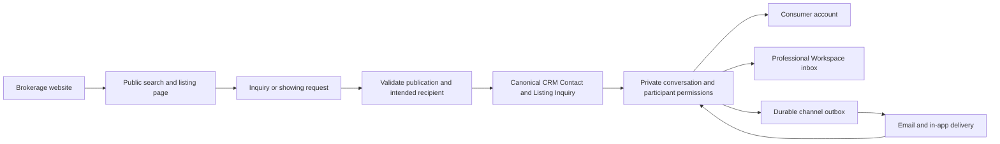

# Public domains, listing discovery, and communications

**Status:** Proposed architecture, not deployed. **Date:** October 8, 2026.

## Recommendation

Keep **`primeamericarealestate.com` as the corporate site** and **`primeamericany.com` as the consumer site**, as confirmed by the user. Propose launching the consumer search at **`search.primeamericany.com`**, after production MLS display approval and production-readiness checks. Keep it as the durable search and listing host through the later Placester replacement. Preserve the consumer site's established apex/www host while building its replacement. Consumers can move between the consumer website, search, and their account without knowing which service handles each page.

This reflects the user's clarified preferences: distinct corporate and consumer domains, a quiet public launch once MLS approval is ready, and avoiding dependency on the Placester editor. The corporate domain remains the company-facing site; the consumer domain remains the home for consumer discovery and connection. A new unrelated consumer domain would introduce a separate brand and a separate migration problem. `search.primeamericany.com` provides service independence while retaining the existing recognizable consumer domain.

The public address and the implementation behind it are separate decisions. A Worker can be replaced, the UI can be embedded, and the brokerage host can move away from Placester while the established listing address stays valid. See [ADR 014](adr/014-durable-consumer-search-origin.md) and the [primary-source research](domain-discovery-provider-research.md).

## What exists today

Public DNS observations below were made on October 8. Repository configuration establishes intended service routing, not proof of a successful live deployment.

| Address or record | Observed or configured responsibility | Confidence and action |
| --- | --- | --- |
| `primeamericany.com` / `www.primeamericany.com` | Consumer website on Placester, per user. Apex A observed as `184.169.141.142`; www CNAME as `domains.myrealestateplatform.com` | Preserve. Verify actual apex/www redirects, certificates, indexed URLs, and hosting settings before replacement |
| Both brokerage domains' nameservers | `igor.ns.cloudflare.com`, `melany.ns.cloudflare.com` | Public DNS verified; Cloudflare already manages authoritative DNS |
| `primeamericarealestate.com` apex | Corporate site, confirmed by user; domain documentation identifies an Astro Corporate Site service | Public role confirmed; exact hosting/canonical settings not inspected |
| `workspace.primeamericany.com` | Existing Workspace gateway route; public CNAME to `re-workspace.lama-4db.workers.dev` | DNS and repository route verified; preserve professional login and work |
| `app.primeamericarealestate.com` | Additional Workspace route in `wrangler.toml` | Repository configuration; avoid changing active bookmarks/session flows |
| `inventory.primeamericarealestate.com` | Inventory / Listing Input service | Repository configuration; retain canonical Property ownership |
| `openhouse.primeamericarealestate.com` | Open House service | Repository configuration; retain CRM attribution and consent |
| `inside.primeamericarealestate.com` | Brand & Marketing Hub | Existing domain documentation; retain existing profile mapping and login handoff |
| `auth.primeamericarealestate.com` | Planned central Better Auth service | Migration pending; do not treat it as the active authority merely because configuration exists |
| `prime.searchtolive.com` | Additional gateway hostname configured in `wrangler.toml` | Its intended product role and live deployment need confirmation; do not turn it into a second indexable copy of Prime America's listings |
| `primeamericany.com` MX | Google's `aspmx.l.google.com` family | Public DNS verified; preserve employee mailbox delivery |
| `primeamericarealestate.com` MX | Cloudflare `route1/2/3.mx.cloudflare.net` | Public DNS verified; existing routing destinations/account configuration not inspected |
| `_dmarc.primeamericarealestate.com` | `v=DMARC1; p=reject;` | Public DNS verified; new senders need aligned authentication before using this domain |
| `search.primeamericany.com` | No A answer returned by the performed query | Proposed hostname; check the zone for existing records before creating it |

Public DNS does not establish every dashboard setting or account permission. The limited MX/DMARC queries are not a complete deliverability audit. The web research fetch could not reliably retrieve the current brokerage site; that is not evidence that the site is down for visitors. Existing URL/canonical history remains an explicit pre-migration task.

## Proposed address map

All new addresses below are proposals. No DNS records or production routes have been changed.

| Surface | Proposed address | Access and indexing |
| --- | --- | --- |
| Corporate website | `primeamericarealestate.com` | Confirmed corporate domain; preserve its distinct company-facing role |
| Consumer website | Current canonical apex or www of `primeamericany.com` | Confirmed consumer domain; public, indexable; preserve the established host choice |
| Search home | `search.primeamericany.com/` | Public, indexable introduction and crawlable navigation |
| Sales, rentals, commercial, investors | `/homes/`, `/rentals/`, `/commercial/`, `/invest/` on search host | Selected useful landing pages; distinct consumer journeys |
| Borough landing pages | For example `/rentals/queens/`, `/homes/brooklyn/` | Public where useful content and permitted inventory justify them; all five boroughs supported |
| Interactive filter state | `/search?borough=Queens&type=ResidentialLease&...` | Shareable results; controlled indexing, not unlimited SEO pages |
| Public listing details | `/listing/<source>/<source-listing-key>` | One durable canonical URL per source Listing, full server-rendered page |
| Optional short link | `/l/<public-alias>` | Redirect to the eligible canonical Listing; opaque alias registry, no second HTML copy |
| Private exclusive | `/s/<random-revocable-token>` | Anyone holding the link, as requested; no index/sitemap/public previews |
| Embedded search | `/embed?...` | Presentation adapter using the same public data and branding; no competing canonical listing pages |
| Consumer account | `my.primeamericany.com` | Authenticated saved homes, conversations, showing requests and preferences; no public indexing |
| Professional conversations | `workspace.primeamericany.com/communications` | Proposed page inside existing Workspace; role- and tenant-scoped |
| Public service endpoints | Search host `/api/search`, `/api/inquiries`, `/api/showing-requests` | Public entry points with validated inputs, rate controls and explicit publication/recipient checks |
| Consumer conversation endpoints | Same-origin APIs on `my.primeamericany.com` | Authenticated; internal services reached through private bindings |
| Listing media | Initially same search host `/media/...` | Eligibility-aware public assets; separate authorized private-media path |
| Transactional email sender | For example `hello@updates.primeamericany.com` | Proposed authenticated sending identity; provider/domain verification required |
| Inbound conversation replies | For example `<opaque-route>@reply.primeamericany.com` | Proposed dedicated receive subdomain; maps to authorized participants, not public CRM IDs |
| Marketing email | A separately configured sender, if needed | Separate permission and suppression policy; not automatically enabled by an inquiry |
| Private staging | A dedicated preview host or existing local preview | Access protected for staff; demo feed stays out of public production |

Start media on the search host to avoid adding a connection and an extra domain prematurely. Introduce a dedicated media hostname only when measured delivery/storage needs justify it; keep URLs under brokerage control and apply revocation to every derivative and cached representation.

Keep the corporate site at `primeamericarealestate.com` distinct from consumer listing publication. Corporate pages can link to canonical consumer listing/search URLs instead of publishing competing copies. Keep the configured `searchtolive.com` surface in the inventory without making it another consumer listing authority. If a separate search brand is later selected, make that a deliberate brand, MLS installation, and URL migration decision. Future customer-owned domains may require Cloudflare for SaaS; our own controlled subdomains do not require that product. Internal CRM, Transactions, ingestion and communications services need private bindings, not a new public hostname each.

## Listing URL contract

The existing local adapter already uses `/listing/<source>/<id>`. Preserve that source-qualified identity contract when choosing the production origin. The source and key together identify a **Listing**, not a new **Property**. A sale listing and a rental listing for the same premises can be separate marketing episodes. Relisting must not silently overwrite an old episode's identity. Cross-source records may be linked to a Property through Inventory's evidence-based identity resolution; do not merge them solely because their addresses look alike.

For example, `https://search.primeamericany.com/listing/onekey2/KEY426834603` illustrates the current local route format; it is not a deployed public link. Share buttons strip density, view, pagination, campaign and filter state from listing links. Sharing a search retains useful filter state through a normalized search URL. Presentation preferences remain separate from the canonical Listing identity.

An optional short alias can redirect to the canonical URL. It must remain mapped to the same Listing and recheck eligibility before redirecting. Address slugs can be added later for readability, with permanent redirects from alternate paths; a slug is not a substitute for stable identity or a ranking guarantee. Never put prices, phone numbers, client names, or private addresses in access tokens.

Private links are a separate publication mechanism. A forwarded link grants access under the user's chosen policy. Use unpredictable, revocable tokens; redact tokens from analytics/logs, prevent referrer leakage, use private/no-store responses, and keep private photos out of public media caches. A private sharing token grants no access to conversations or customer accounts. Public-to-private transitions invalidate public HTML, image derivatives, short redirects, metadata and sitemap entries. External social/search caches may take time to update after removal.

If display permission ends, purge public content and return the appropriate unavailable/404/410 response. Do not automatically retain a historical listing page because it once ranked. Closed listings stay public only when the source license permits that display. Existing communications can retain authorized transaction/inquiry records according to the applicable retention policy without republishing revoked MLS fields.

## Search and AI discovery

The design helps discovery by making useful, current information easy to retrieve and share. Domain names alone cannot guarantee first place in search or an AI answer. Google treats subdomains versus subdirectories as an organizational choice. [Google SEO starter guide](https://developers.google.com/search/docs/fundamentals/seo-starter-guide).

1. Serve complete, accessible listing HTML at the canonical link: factual title, address where permitted, price/status/type, public features, source attribution, brokerage identity, applicable display notices, media and an honest freshness explanation. Render the same permitted facts for visitors and crawlers. Keep personalization out of the shared canonical facts.
2. Provide canonical tags, self-consistent internal links, source-eligible sitemaps and useful social preview metadata. Index selected category/borough pages. Do not publish thousands of thin parameter combinations. For paginated browse pages that are intentionally indexable, provide distinct URLs and crawlable navigation; do not canonicalize every distinct inventory page to page one. [Canonical guidance](https://developers.google.com/search/docs/crawling-indexing/consolidate-duplicate-urls), [faceted navigation](https://developers.google.com/crawling/docs/faceted-navigation).
3. Own `/robots.txt` and `/sitemap.xml` on the search subdomain. Submit its verified property to Google Search Console and Bing Webmaster Tools. A root-domain sitemap need not be edited to launch an independent subdomain; the new host needs its own discovery and monitoring. Avoid contradictory robots blocks and noindex directives: blocked pages may not be fetched to observe noindex.
4. Add truthful semantic metadata matching visible content. Organization/RealEstateAgent and breadcrumbs can help describe the brokerage and pages; listing schema is not a promise of a Google real-estate rich result. Use unique editorial guidance, rights explanations and original own-listing material that consumers can actually use, with qualified review and dates where appropriate. [Google structured-data policies](https://developers.google.com/search/docs/appearance/structured-data/sd-policies).
5. Recheck current AI-discovery settings at rollout. Google's current guidance links to Search Console's generative-AI inclusion control; verify the effective setting for the search host and its parent. Its documentation says `llms.txt` does not improve Google visibility or rankings. [Google AI guide](https://developers.google.com/search/docs/fundamentals/ai-optimization-guide), [inclusion control](https://support.google.com/webmasters/answer/16908024).
6. Treat search retrieval and training separately. OpenAI documents independent `OAI-SearchBot` and `GPTBot` controls. Allow search discovery only for content whose executed agreements permit it; do not interpret our own MLS AI search addendum as blanket authorization for model training, bulk export or third-party redistribution. An optional `llms.txt` can describe our own editorial/navigation content, but is not a privacy or licensing control. [OpenAI crawlers](https://developers.openai.com/api/docs/bots).

Duplicate MLS facts are widely available. Prime America's useful distinction should come from trustworthy source handling, clear total-cost explanations, accurate consumer rights information, original permitted media, and a reliable connection to the right listing professional. Avoid generated neighborhood demographic targeting, unsupported urgency, or manufactured availability claims.

## Coexistence and replacement

**Phase 1 — prepare independently.** Provision an isolated search installation and staff preview. Port the local Node/SQLite demo to a production adapter with durable data ingestion, publication checks, source-qualified identities, SSR, media handling and inquiry delivery. The current demo's local inquiry store and brand-save endpoint are not production services. Resolve the data reliability issues documented in the [data management audit](mls-grid-data-management-audit.md). Keep demo records private; production display approval is necessary but not sufficient to launch an unfinished adapter.

**Phase 2 — quiet public launch.** Launch the approved public inventory at `search.primeamericany.com` with complete standalone navigation, brokerage identity and direct listing URLs. Confirm that this specific installation/hostname is authorized under each source's agreements and display rules; a subscription for another website is not assumed to authorize a new deployment. Without any Placester changes, it can receive shared links and begin independent discovery, but visitors to Placester will not automatically encounter it. When a supported site-level link change is available, connect Placester's Search/Buy/Rent navigation to the service. An iframe is optional, dependent on verified account capabilities, and is not required for this launch. Do not inject unapproved code or replace a whole Placester hostname to achieve an undisclosed embed.

**Phase 3 — rebuild the consumer website.** Replace the Placester consumer site at `primeamericany.com`, reproducing and improving its design language using reviewed brand tokens, responsive components and accessible interactions. Preserve the established apex/www canonical host and valuable existing paths. Link to or embed the same search service; full listing details remain at the already established canonical search URLs. Integrate consumer account actions and professional routing behind the visible brand. The corporate site remains at `primeamericarealestate.com`.

**Phase 4 — controlled host cutover.** First inventory Placester pages, existing listing URLs, forms, campaigns, analytics, robots/sitemaps, redirects, hosting records and mailbox configuration. Test the replacement on staging. Map each valuable changed URL to a genuinely equivalent page; avoid redirecting every old listing to the home page. Cut over the website while retaining search, workspace and mail routing. Keep a dated DNS/origin/configuration snapshot and a tested rollback. Monitor certificates, HTTP status, indexing, forms, replies and source revocations immediately after cutover. Keep migration redirects generally at least one year. [Google site moves](https://developers.google.com/search/docs/crawling-indexing/site-move-with-url-changes).

Alternative: selected main-host paths can be routed to Workers before the full replacement if Placester/proxy compatibility is verified. Worker Routes require proxied DNS; Custom Domains make the Worker the origin for an entire host. Do not assign apex/www as a Worker Custom Domain while expecting Placester to keep serving the rest. This option requires origin Host/SNI/TLS validation, path collision analysis and explicit robots/sitemap ownership. The independent search subdomain avoids making that investigation a launch dependency. [Worker Routes](https://developers.cloudflare.com/workers/configuration/routing/routes/), [Custom Domains](https://developers.cloudflare.com/workers/configuration/routing/custom-domains/).

## Communications engine: one conversation, two appropriate views

Consumers should see **“Message the listing team”**, **“Request a showing”**, **“Your messages”**, and **“Waiting for confirmation.”** Professionals should see the corresponding conversation, listing context, assigned responsibility, outstanding response and next action in Workspace. Accurate labels distinguish the listing brokerage, listing salesperson, Prime America's assistance role, and an existing buyer's representative. Routing must never imply that a salesperson represents the consumer just because an inquiry was submitted.

An inquiry can be submitted without requiring a browsing account. Verify access before granting a portal session or conversation history. Reference canonical CRM Contacts; do not create a competing consumer identity database or merge people by name. The existing CRM source-link integration and agent notification jobs are useful foundations, but they do not yet establish a complete two-way conversation engine or a per-channel consent ledger. Extend their domain ownership rather than duplicating them. See [ADR 004](adr/004-cross-app-sources-link-to-canonical-crm-contacts.md), [ADR 006](adr/006-person-evidence-documents-events-and-consent.md), and [ADR 009](adr/009-listing-inquiries-and-showing-appointments.md).

Proposed first release:

- A property-specific conversation with an explicit intended recipient, source attribution, source timestamps and a Listing Inquiry reference. An external listing brokerage is not automatically a Prime America tenant/user or a verified participant merely because it appears in MLS data. Use permitted, verified listing contact channels and label any Prime America fallback clearly; never silently reroute the inquiry to an unrelated sponsored agent.
- One assigned responder, shared access for authorized team members, broker supervision, response reminders and escalation. Keep internal notes and draft replies separate from consumer-visible messages. Inviting the consumer's existing representative requires explicit participation permissions; it does not expose unrelated conversations or another brokerage's CRM.
- A date/time request with a stated timezone, followed by an actual confirmation workflow. Requested, received, accepted by a mail provider, delivered where evidenced, and appointment confirmed are distinct facts. Do not label an email “read” from an open pixel or a requested slot “booked.” Store instants in UTC and present New York appointments in clearly labeled local time.
- In-app history plus transactional email and inbound replies. A durable outbox records retries, provider message IDs and failure/suppression state. Deduplicate client commands, inbound replies and provider events. Exactly-once recipient delivery cannot be assumed: existing notification code already identifies a provider-acceptance/crash duplication window.
- Explicit channel consent, source/capture/revocation evidence and recipient preferences. A request to discuss one property does not subscribe someone to marketing. Add SMS only after the provider, consent, registration, cost and applicable legal requirements are verified.
- AI may help summarize or draft authorized conversations with appropriate review and provider/data controls. MLS-derived search comparisons require the executed addendum; marketing transformations of other firms' listings are not covered by the supplied permission categories. No invented listing answers, automatic representation claims or automatic offer/appointment commitments.

### Authentication and mail boundaries

Public discovery, private conversations and professional tools are different access surfaces. Use host-only consumer sessions, authenticated APIs, tenant/participant checks and private/no-store responses. An iframe should hand login and sensitive account actions to a top-level account page, rather than depend on third-party cookies. Search hosts allow only approved embed origins and carefully validate cross-window messages.

The active Workspace identity authority must remain consistent with [ADR 012](adr/012-hub-workspace-login-and-profile-mapping.md). The planned `.primeamericarealestate.com` auth cookie cannot cover `primeamericany.com`. Use a tested, signed, short-lived, single-use redirect/session exchange across those domains when required; do not broaden cookies over Placester's domain to simplify an embed. Consumer identities and CRM Contacts are linked through verified evidence, not by assuming every visitor is an employee. Central auth cutover is a separate migration. [Cookie scope](https://developer.mozilla.org/en-US/docs/Web/HTTP/Guides/Cookies).

Preserve the existing apex mailbox MX records. Configure new sending/receiving subdomains independently with the chosen provider's SPF/DKIM/DMARC and aligned From identity, and handle bounces, complaints and suppression. A friendly From name should identify the actual brokerage/professional; do not spoof another firm's agent address. Reply route tokens identify a conversation delivery route, and inbound mail must also validate the expected sender/participant; possessing a token is not permission to view an account. Filter attachments and avoid placing private message bodies in public notification URLs or third-party analytics.

Cloudflare currently documents transactional Email Sending and inbound Email Routing, which is a plausible fit with the existing `EMAIL` binding. Verify this account's outbound entitlement, inbound setup, event support, quota, authentication and recovery behavior before selecting it as the entire communications transport. MX records alone do not prove outbound sending readiness. [Cloudflare Email Service](https://developers.cloudflare.com/email-service/).

## Delivery, cost and release checks

Operate search from a local replicated/indexed eligible data store; consumer filters should not issue an upstream MLS request for every keystroke. Revalidate publication/version before rendering or delivering media. Cache public representations under an explicit removal policy; sensitive conversations and private exclusives bypass public caching. Responsive images, reserved image dimensions and lazy loading below the fold should support fast listing pages without delaying removal.

Track actual costs for MLS licenses, ingestion work, media bytes/variants, storage, Worker/database traffic, transactional sends, SMS, observability and operational support. Compare these to current Placester costs before claiming savings. The user's roughly $200/month MLS estimate is context, not a verified subscription quote or the complete operating budget. Modular ownership lets us replace a delivery provider without changing consumer URLs or CRM identity.

Before public release, verify:

- Executed source-specific display permissions and notices, public/private scope, crawler/AI terms and production inventory segregation.
- Freshness, source-version guards, revocation, cache/media removal and outage behavior using the audited data flow.
- Standalone crawlable HTML, canonical/share metadata, robots/sitemaps, eligible links, useful landing pages and filter/pagination behavior.
- Mobile and keyboard access, clear focus and error recovery, non-JavaScript listing facts, correct recipient labels, consent and timezone handling.
- Auth/session boundaries, unauthorized conversation access, external-recipient validation, durable inquiry intake and witnessed delivery/reply failures.
- Baseline redirects/index history, DNS/SSL/mail snapshot, rollback and independent synthetic checks of search, inquiry intake and replies.

Measure eligible indexed canonical pages, crawl errors, first useful content, listing update/removal latency, shares, inquiry delivery, time to human response, confirmed showings, offers and completed transactions. Separate observed organic/AI referrals from estimated impressions and from internal tests. A million views is not a substitute for an inquiry reaching the right person and receiving a useful reply.

## Outstanding decisions

The corporate/consumer domain distinction is confirmed: `primeamericarealestate.com` remains corporate and `primeamericany.com` remains consumer. The search/account subdomains are still proposed. Confirm ownership/product intent for the configured `prime.searchtolive.com` hostname before allocating it a consumer brand role. Placester plan/editor/proxy and navigation controls are unknown; they are optional for the independent search launch and required only for changes inside the existing site. DNS zone records, provider contracts, Search Console access, sending entitlements and a production search adapter still need verification before deployment. This document records a reviewable proposal, not approval to change those systems.
